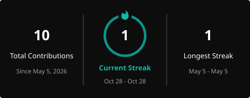

<!-- Header Banner -->


<div align="center">

<!-- Typing Animation -->


<br/>

<!-- Social Badges -->
[](https://gbpatilan.github.io)
[](https://www.linkedin.com/in/gerald-b-patilan/)
[](mailto:gbpatilan@gmail.com)
[](#)

</div>

---

## 👨‍💻 About Me

```java
public class Gerald {
    String role        = "Full Stack Developer";
    String company     = "CareTech Health Digital (CareSpan Asia, Inc.)";
    String location    = "Metro Manila, Philippines";
    String domain      = "Healthcare Technology";

    String[] buildsFor = { "Outpatient", "Inpatient", "HIS", "ERP" };
    String[] programs  = { "PhilHealth YAKAP/Konsulta", "eClaims", "DOH-FHSIS", "SHF-PCPN" };
    String[] standards = { "HL7 FHIR", "PHCDI" };
    String[] stack     = { "Java", "Spring Boot", "React", "Node.js", "PHP", "PostgreSQL", "MySQL", "Docker" };
}
```

I'm a **Full Stack Developer** with 3+ years building **EMR, Hospital Information System (HIS), ERP and healthcare applications** used by clinics and hospitals across the Philippines.

My path into software runs through the healthcare system itself: health insurance claims support, financial systems at **PhilHealth Head Office**, EMR implementation for clinics, and now full-stack engineering. That gives me something most developers don't have: I know how PhilHealth programs, DOH reporting and clinic workflows actually work, and I build software that fits them.

<table>
<tr>
<td width="50%" valign="top">

**What I bring**

- Healthcare domain expertise: PhilHealth, DOH, clinic operations
- Compliance-driven, reliable software
- Interoperability with HL7 FHIR and PHCDI standards
- QA mindset: test strategy, planning and execution
- Clear communication with clinicians, QA and product teams

</td>
<td width="50%" valign="top">

**Core expertise**

- Java · Spring Boot · REST APIs
- React.js · JavaScript · Node.js
- PHP (CodeIgniter, Laravel)
- PostgreSQL · MySQL · SQL optimization
- XML / JSON data exchange · Docker
- Agile/Scrum · Business Systems Analysis

</td>
</tr>
</table>

---

## 🛠 Tech Stack

<div align="center">

### Languages & Frameworks
[](https://skillicons.dev)

### Databases, DevOps & Tools
[](https://skillicons.dev)

<br/>

| Frontend | Backend | Data & Integration | Healthcare |
|:--------:|:-------:|:------------------:|:----------:|
| React.js · JavaScript | Java · Spring Boot | PostgreSQL · MySQL | PhilHealth YAKAP / Konsulta |
| HTML5 · CSS3 | PHP · CodeIgniter · Laravel | REST APIs · XML · JSON | eClaims (TB-DOTS, ABTC, HIV, Malaria) |
| Responsive clinical UIs | Node.js | HL7 FHIR · PHCDI | DOH-FHSIS reporting |
| Figma | JWT auth | Docker · Git | EMR · HIS · ERP |

</div>

---

## 📊 GitHub Analytics

<div align="center">



<br/><br/>

<a href="https://github.com/gbpatilan">
  
</a>

</div>

---

## 💼 Professional Experience

| Period | Role | Organization | Highlights |
|:------:|:-----|:-------------|:-----------|
| **Sep 2025 – Present** | Full Stack Developer | **CareTech Health Digital** (CareSpan Asia, Inc.) | Outpatient, Inpatient, HIS & ERP platforms used nationwide; React UIs, CodeIgniter REST APIs, PostgreSQL/MySQL, Docker |
| **Jul 2024 – Sep 2025** | IT Associate — Subject Matter Expert | **CareTech Health Digital** | SME for the CareSpan Integrated Platform; EMR onboarding; YAKAP/Konsulta & eClaims modules; HL7 FHIR / PHCDI; DOH-FHSIS compliance |
| **Jan 2025 – Jun 2025** | Quality Assurance Tester | **CareTech Health** | Led QA for the Konsulta Management System: test strategy, plans and execution |
| **Apr 2023 – Jul 2024** | Financial Systems Analyst | **PhilHealth** Head Office | SHF-PCPN IT System & web portal; financial data reconciliation; SQL reporting; regional PCPN capability building |
| **Oct 2022 – Apr 2023** | Customer Service Representative II | **Foundever** | U.S. healthcare insurance accounts (UnitedHealthcare, Cigna); claims, billing & EDI workflows |
| **Oct 2021 – Oct 2022** | Sales & Technical Support Representative | **G2 Software Solutions** | IT needs assessments and software recommendations for LGUs in Leyte |

---

## 🚀 Featured Projects

<div align="center">

<table>
<tr>
<td width="50%" valign="top">

### 🏥 PhilHealth-Certified EMR Providers

[](https://github.com/gbpatilan/philhealth-certified-emr-providers)

- Dashboard of **PhilHealth-certified YAKAP EMR providers**
- Makes the certified-provider list easy to browse and compare
- Built for clinics choosing an EMR for YAKAP/Konsulta

</td>
<td width="50%" valign="top">

### 🏛️ BIMS — Barangay Information Management System


- Full-stack app for barangay resident records, documents and services
- **Java Spring Boot** REST API secured with **JWT**
- Vanilla JS frontend · MySQL

</td>
</tr>
<tr>
<td width="50%" valign="top">

### 🏨 Villa Noche Pensione House


- Hotel booking site: browse rooms, check availability, reserve online
- **React · Node.js · MySQL**

</td>
<td width="50%" valign="top">

### 🎓 SMIS — Student Management Information System


- Student records, enrollment and grades for schools
- **VB.NET · MySQL**

</td>
</tr>
</table>

</div>

---

## 🎓 Education & Certifications

<div align="center">

**Bachelor of Science in Information Technology** — AMA Computer College, Tacloban Campus

</div>

| Year | Certification |
|:----:|:--------------|
| 2025 | Advanced Java Programming: Spring Framework, Web Apps & APIs |
| 2025 | Build Modern Web Applications with Laravel and React |
| 2025 | Philippine Core Data for Interoperability (PHCDI) Orientation |
| 2024 | NHDR Enterprise Architecture Workshop |
| 2024 | Capability Building for PhilHealth Regional Offices on PCPN Implementation |
| 2024 | Career Boost with Power BI — Exodus Experts |
| 2024 | Web Development 101: Building Your First Front-End — Xaltius Academy |
| 2023 | Short Course on the Establishment of Special Health Fund — Zuellig Family Foundation |
| 2022 | CCNA: Enterprise Networking, Security, and Automation — Cisco Networking Academy |
| 2021 | DevNet Associate — Cisco Networking Academy |

---

## 📫 Let's Connect

<div align="center">

Open to conversations about **healthcare technology**, **EMR/HIS development** and **interoperability**.

<br/>

[](https://gbpatilan.github.io)
[](https://www.linkedin.com/in/gerald-b-patilan/)
[](mailto:gbpatilan@gmail.com)

<br/>


</div>


